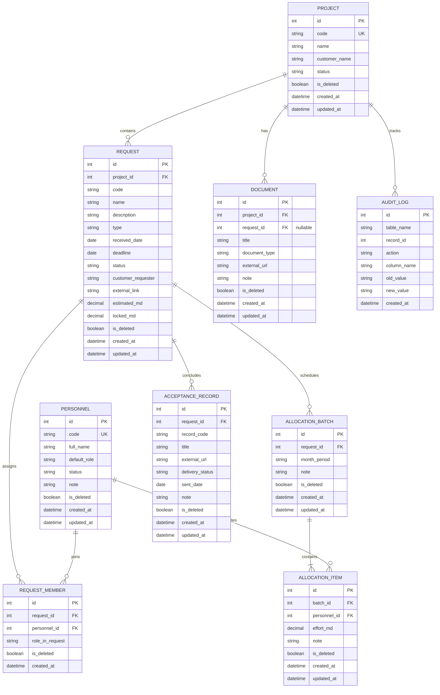

# 01. Phân tích Nghiệp vụ, Mô hình Dữ liệu (ERD), Business Rules & Test Cases

> **Dự án**: Hệ thống Quản lý Dự án Outsource Nội bộ (Outsource PM)
> **Phiên bản**: 1.0 (MVP) — Đã đồng bộ với Prototype [Main.dc.html](../Main.dc.html)

---

## 0. Kiến trúc Công nghệ Đề xuất (MVP)

* **Frontend**: Angular (TypeScript), áp dụng Design System từ Prototype (`IBM Plex Sans`, `IBM Plex Mono`, bảng màu `#1E40AF` / `#F6F7F9`).
* **Backend**: **Node.js (NestJS + TypeScript)** — Dùng chung hệ sinh thái TypeScript với Angular, dễ dàng chia sẻ DTO/Interface và đóng gói.
* **CSDL**: **SQLite** (lưu dạng file cục bộ `.db`, kết nối qua Prisma ORM / TypeORM / `better-sqlite3`).
  * *Lý do*: Hệ thống phục vụ đúng **1 người dùng (Project Leader)**, không cần cài đặt DB Server phức tạp, zero-config, sao lưu chỉ cần copy 1 file `.db` duy nhất, dễ dàng nâng cấp lên PostgreSQL khi mở rộng.

---

## 1. Phạm vi, Actor & Quy ước Chuẩn hóa

### 1.1. Actor & Phạm vi Tổng quan
* **Actor duy nhất**: **Project Leader** (Toàn quyền CRUD, không đăng nhập, không phân quyền RBAC).
* **Phạm vi nghiệp vụ**:
  1. **Danh mục Nhân sự**: Quản lý mã, họ tên, vai trò chính, trạng thái (`Đang làm` / `Nghỉ`), ghi chú.
  2. **Quản lý Đa Dự án (`PROJECT`)**: Tạo, sửa, chuyển đổi dự án đang làm việc, xóa mềm và khôi phục dự án.
  3. **Quản lý PYC (`REQUEST`)**: Thuộc từng dự án, gồm mã PYC (tự sinh hoặc nhập tay), tên, loại (`CR`, `Bug`, `Dự án mới`, `Hỗ trợ`), ngày nhận, hạn hoàn thành, trạng thái, người yêu cầu phía khách, link ngoài (Jira/ITSM), nỗ lực ước tính (`est`) và **nỗ lực chốt (`chot`)**.
  4. **Nhân sự tham gia PYC (`REQUEST_MEMBER`)**: Gán nhân sự từ danh mục vào PYC kèm vai trò cụ thể trong PYC.
  5. **Phân bổ nỗ lực cuối tháng (`ALLOCATION_BATCH` & `ALLOCATION_ITEM`)**: Mỗi đợt gắn với 1 PYC + 1 tháng (`YYYY-MM`), gồm nhiều dòng nhân sự + số `md` + ghi chú.
  6. **Hồ sơ dự án (`DOCUMENT`) & Biên bản nghiệm thu (`ACCEPTANCE_RECORD`)**: Lưu metadata và URL liên kết (SharePoint/Drive/Confluence); theo dõi trạng thái gửi khách (`Chưa gửi` / `Đã gửi` kèm ngày gửi).
  7. **Import/Export Excel, Audit Log & Xóa mềm (Soft Delete + Khôi phục)**.

### 1.2. Quy ước Chuẩn hóa
1. **Đơn vị nỗ lực**:
   * Đơn vị cơ sở: **man-day (`md`)**, kiểu số thập phân 1 chữ số (`DECIMAL(10,1)`), bước nhập `0.1`.
   * Quy đổi tháng: `1 man-month (mm) = 22 md` (`mm = ROUND(md / 22, 2)`).
2. **Khóa logic tháng phân bổ**: Mỗi PYC trong 1 tháng dương lịch (`YYYY-MM`) có tối đa **1 Đợt phân bổ** hiệu lực (`is_deleted = FALSE`).
3. **Nỗ lực chốt (`locked_md`)**: Là căn cứ kiểm soát trần phân bổ. `Đã phân bổ = SUM(effort_md)`, `Còn lại = Chốt - Đã phân bổ`.

---

## 2. Danh sách Use Case Chính

| STT | Mã UC | Tên Use Case | Mô tả tóm tắt | Ràng buộc chính |
| :--- | :--- | :--- | :--- | :--- |
| 1 | **UC-01** | Quản lý Nhân sự | Thêm, sửa, đổi trạng thái (`Đang làm` / `Nghỉ`), xóa mềm/khôi phục | Mã NS là duy nhất. Không xóa cứng. |
| 2 | **UC-02** | Quản lý Dự án | Tạo mới, sửa, chuyển đổi dự án, xóa mềm/khôi phục dự án | Mã dự án (`DA-xx`) duy nhất. |
| 3 | **UC-03** | Quản lý PYC | Thêm/sửa PYC theo dự án, nhập nỗ lực ước tính & nỗ lực chốt | Mã PYC duy nhất trong cùng 1 dự án. |
| 4 | **UC-04** | Gán Nhân sự vào PYC | Thêm/gỡ nhân sự từ danh mục vào PYC, gán vai trò trong PYC | Chỉ nhân sự `Đang làm` mới được gán mới. |
| 5 | **UC-05** | Phân bổ nỗ lực cuối tháng | Tạo/sửa đợt theo tháng `YYYY-MM`, nhập `md` cho từng nhân sự | Tổng phân bổ `<=` Nỗ lực chốt. Bước nhảy `0.1`. |
| 6 | **UC-06** | Quản lý Hồ sơ & Biên bản | Lưu link tài liệu dự án/PYC, quản lý BBNT, cập nhật trạng thái gửi khách | 1 BBNT gắn 1 PYC; 1 PYC có thể có nhiều BBNT. |
| 7 | **UC-07** | Tra cứu Audit Log | Xem lịch sử thay đổi (`INSERT`, `UPDATE`, `SOFT_DELETE`, `RESTORE`) | Tự động ghi nhận mọi thay đổi kèm giá trị cũ → mới. |
| 8 | **UC-08** | Đã xóa / Khôi phục | Xem danh sách bản ghi đã xóa mềm và khôi phục lại | Kiểm tra ràng buộc vượt chốt (BR-01) khi khôi phục. |
| 9 | **UC-09** | Import/Export Excel | Nhập danh mục NS/PYC/Phân bổ và Xuất danh sách, báo cáo, BBNT | Dry-run kiểm tra lỗi theo dòng, Upsert chống trùng. |

---

## 3. Sơ đồ ERD & Đặc tả Bảng Dữ liệu

### 3.1. Sơ đồ ERD (Mermaid)

### 3.2. Đặc tả Chi tiết Các Bảng

#### 1. Bảng `PROJECT` (Dự án)
| Tên trường | Kiểu dữ liệu | Ràng buộc | Diễn giải |
| :--- | :--- | :--- | :--- |
| `id` | INTEGER | PK, Auto Increment | Khóa chính |
| `code` | VARCHAR(50) | NOT NULL, UNIQUE | Mã dự án (VD: `DA-01`, `DA-02`) |
| `name` | VARCHAR(255) | NOT NULL | Tên dự án |
| `customer_name` | VARCHAR(255) | NULL | Tên khách hàng / Đơn vị đối tác |
| `status` | VARCHAR(30) | NOT NULL, DEFAULT `'ACTIVE'` | `ACTIVE` (Đang thực hiện), `ON_HOLD` (Tạm dừng), `COMPLETED` (Hoàn thành) |
| `is_deleted` | BOOLEAN | NOT NULL, DEFAULT FALSE | Cờ xóa mềm |
| `created_at` | DATETIME | NOT NULL | Thời điểm tạo |
| `updated_at` | DATETIME | NOT NULL | Thời điểm cập nhật |

#### 2. Bảng `PERSONNEL` (Danh mục Nhân sự)
| Tên trường | Kiểu dữ liệu | Ràng buộc | Diễn giải |
| :--- | :--- | :--- | :--- |
| `id` | INTEGER | PK, Auto Increment | Khóa chính |
| `code` | VARCHAR(50) | NOT NULL, UNIQUE | Mã nhân sự (VD: `NS01`) |
| `full_name` | VARCHAR(255) | NOT NULL | Họ và tên |
| `default_role` | VARCHAR(100) | NOT NULL | Vai trò chính: `Dev`, `Tester`, `BA`, `PM` |
| `status` | VARCHAR(20) | NOT NULL, DEFAULT `'ACTIVE'` | `ACTIVE` (`dang_lam`), `INACTIVE` (`nghi`) |
| `note` | TEXT | NULL | Ghi chú chuyên môn |
| `is_deleted` | BOOLEAN | NOT NULL, DEFAULT FALSE | Cờ xóa mềm |

#### 3. Bảng `REQUEST` (PYC - Yêu cầu công việc)
| Tên trường | Kiểu dữ liệu | Ràng buộc | Diễn giải |
| :--- | :--- | :--- | :--- |
| `id` | INTEGER | PK, Auto Increment | Khóa chính |
| `project_id` | INTEGER | FK -> `PROJECT(id)`, NOT NULL | Thuộc dự án nào |
| `code` | VARCHAR(100) | NOT NULL | Mã PYC (`UNIQUE(project_id, code)` khi `is_deleted=FALSE`) |
| `name` | VARCHAR(255) | NOT NULL | Tên PYC |
| `description` | TEXT | NULL | Mô tả yêu cầu |
| `type` | VARCHAR(50) | NOT NULL | `CR`, `Bug`, `Dự án mới`, `Hỗ trợ` |
| `received_date` | DATE | NULL | Ngày nhận yêu cầu |
| `deadline` | DATE | NULL | Hạn hoàn thành cam kết |
| `status` | VARCHAR(30) | NOT NULL, DEFAULT `'Mới'` | `Mới`, `Đang làm`, `Chờ nghiệm thu`, `Đã nghiệm thu`, `Đóng` |
| `customer_requester` | VARCHAR(255) | NULL | Người yêu cầu phía khách |
| `external_link` | VARCHAR(1000) | NULL | Link Jira / ITSM / Redmine |
| `estimated_md` | DECIMAL(10,1) | NULL, DEFAULT 0.0 | Nỗ lực ước tính (tùy chọn) |
| `locked_md` | DECIMAL(10,1) | NOT NULL, DEFAULT 0.0 | **Nỗ lực chốt** (`>= 0`, bước `0.1`) |
| `is_deleted` | BOOLEAN | NOT NULL, DEFAULT FALSE | Cờ xóa mềm |

#### 4. Bảng `REQUEST_MEMBER` (Nhân sự tham gia PYC)
| Tên trường | Kiểu dữ liệu | Ràng buộc | Diễn giải |
| :--- | :--- | :--- | :--- |
| `id` | INTEGER | PK, Auto Increment | Khóa chính |
| `request_id` | INTEGER | FK -> `REQUEST(id)`, NOT NULL | Thuộc PYC nào |
| `personnel_id` | INTEGER | FK -> `PERSONNEL(id)`, NOT NULL | Nhân sự tham gia |
| `role_in_request` | VARCHAR(100) | NOT NULL | Vai trò trong PYC (`Dev`, `Lead Dev`, `Tester`, `BA`, `PM`) |
| `is_deleted` | BOOLEAN | NOT NULL, DEFAULT FALSE | Cờ xóa mềm |

#### 5. Bảng `ALLOCATION_BATCH` (Đợt phân bổ theo tháng)
| Tên trường | Kiểu dữ liệu | Ràng buộc | Diễn giải |
| :--- | :--- | :--- | :--- |
| `id` | INTEGER | PK, Auto Increment | Khóa chính |
| `request_id` | INTEGER | FK -> `REQUEST(id)`, NOT NULL | Thuộc PYC nào |
| `month_period` | VARCHAR(7) | NOT NULL | Tháng phân bổ `YYYY-MM` (`UNIQUE(request_id, month_period)`) |
| `note` | TEXT | NULL | Ghi chú đợt phân bổ |
| `is_deleted` | BOOLEAN | NOT NULL, DEFAULT FALSE | Cờ xóa mềm |

#### 6. Bảng `ALLOCATION_ITEM` (Dòng phân bổ chi tiết)
| Tên trường | Kiểu dữ liệu | Ràng buộc | Diễn giải |
| :--- | :--- | :--- | :--- |
| `id` | INTEGER | PK, Auto Increment | Khóa chính |
| `batch_id` | INTEGER | FK -> `ALLOCATION_BATCH(id)`, NOT NULL | Thuộc đợt phân bổ nào |
| `personnel_id` | INTEGER | FK -> `PERSONNEL(id)`, NOT NULL | Nhân sự được phân bổ |
| `effort_md` | DECIMAL(10,1) | NOT NULL | Nỗ lực (`> 0`, bước `0.1`) |
| `note` | VARCHAR(255) | NULL | Ghi chú công việc của dòng |
| `is_deleted` | BOOLEAN | NOT NULL, DEFAULT FALSE | Cờ xóa mềm |

#### 7. Bảng `DOCUMENT` (Hồ sơ dự án)
| Tên trường | Kiểu dữ liệu | Ràng buộc | Diễn giải |
| :--- | :--- | :--- | :--- |
| `id` | INTEGER | PK, Auto Increment | Khóa chính |
| `project_id` | INTEGER | FK -> `PROJECT(id)`, NOT NULL | Thuộc dự án nào |
| `request_id` | INTEGER | FK -> `REQUEST(id)`, NULL | Gắn với PYC cụ thể (hoặc `NULL` nếu là tài liệu chung dự án) |
| `title` | VARCHAR(255) | NOT NULL | Tên hồ sơ / tài liệu |
| `document_type` | VARCHAR(100) | NOT NULL | `SRS / Đặc tả`, `Thiết kế / Kiến trúc`, `Testcase / UAT`, `Hợp đồng / Phụ lục`, `Khác` |
| `external_url` | VARCHAR(1000) | NOT NULL | Link SharePoint / Drive / Confluence |
| `note` | TEXT | NULL | Ghi chú |
| `is_deleted` | BOOLEAN | NOT NULL, DEFAULT FALSE | Cờ xóa mềm |

#### 8. Bảng `ACCEPTANCE_RECORD` (Biên bản nghiệm thu - BBNT)
| Tên trường | Kiểu dữ liệu | Ràng buộc | Diễn giải |
| :--- | :--- | :--- | :--- |
| `id` | INTEGER | PK, Auto Increment | Khóa chính |
| `request_id` | INTEGER | FK -> `REQUEST(id)`, NOT NULL | Gắn với PYC nào |
| `record_code` | VARCHAR(100) | NULL | Mã biên bản (VD: `BBNT-01`) |
| `title` | VARCHAR(255) | NOT NULL | Tên biên bản nghiệm thu |
| `external_url` | VARCHAR(1000) | NOT NULL | Link file biên bản |
| `delivery_status` | VARCHAR(20) | NOT NULL, DEFAULT `'chua_gui'` | `chua_gui` (Chưa gửi) / `da_gui` (Đã gửi) |
| `sent_date` | DATE | NULL | Ngày gửi khách (bắt buộc khi `da_gui`) |
| `note` | TEXT | NULL | Ghi chú |
| `is_deleted` | BOOLEAN | NOT NULL, DEFAULT FALSE | Cờ xóa mềm |

#### 9. Bảng `AUDIT_LOG` (Nhật ký thay đổi)
| Tên trường | Kiểu dữ liệu | Ràng buộc | Diễn giải |
| :--- | :--- | :--- | :--- |
| `id` | INTEGER | PK, Auto Increment | Khóa chính |
| `table_name` | VARCHAR(50) | NOT NULL | Tên bảng (`projects`, `pycs`, `batches`, `staff`, `docs`, `bbnts`) |
| `record_id` | VARCHAR(100) | NOT NULL | Mã hoặc ID bản ghi |
| `action` | VARCHAR(20) | NOT NULL | `INSERT`, `UPDATE`, `SOFT_DELETE`, `RESTORE` |
| `column_name` | VARCHAR(50) | NOT NULL | Tên trường thay đổi |
| `old_value` | TEXT | NULL | Giá trị cũ |
| `new_value` | TEXT | NULL | Giá trị mới |
| `created_at` | DATETIME | NOT NULL | Thời điểm ghi nhận |

---

## 4. Business Rules & Validation

| Mã Rule | Tên quy tắc | Mô tả chi tiết & Hành vi hệ thống | Thông báo lỗi chuẩn |
| :--- | :--- | :--- | :--- |
| **BR-01** | **Chặn vượt nỗ lực chốt** | Tổng nỗ lực phân bổ (`SUM(effort_md)`) của các đợt còn hiệu lực thuộc 1 PYC không được vượt quá `locked_md`. Muốn phân bổ vượt phải sửa tăng `locked_md` trước. | `Vượt nỗ lực chốt! Còn lại tối đa {rem} md.` |
| **BR-02** | **Sửa giảm nỗ lực chốt** | Khi sửa `locked_md` của PYC, giá trị mới không được nhỏ hơn tổng nỗ lực đã phân bổ hiện hành của PYC đó. | `Nỗ lực chốt ({chot} md) không được nhỏ hơn tổng đã phân bổ ({used} md)` |
| **BR-03** | **Nhân sự hợp lệ trong đợt** | Chỉ được chọn phân bổ cho nhân sự đã gán vào PYC (`REQUEST_MEMBER`) và đang ở trạng thái `Đang làm`. Nhân sự chuyển sang `Nghỉ` giữ nguyên lịch sử phân bổ cũ nhưng không được gán vào đợt mới. | `Chỉ được phân bổ cho nhân sự đã gán vào PYC` / `Nhân sự {code} đang ở trạng thái Nghỉ` |
| **BR-04** | **Sửa / Xóa mềm / Khôi phục đợt** | Xóa mềm đợt phân bổ tự động hoàn lại số `md` vào phần `Còn lại` của PYC. Khi khôi phục đợt phân bổ từ thùng rác, hệ thống kiểm tra lại BR-01 (nếu vượt số chốt hiện tại thì chặn khôi phục). | `Không thể khôi phục đợt {thang}: tổng phân bổ ({total} md) sẽ vượt nỗ lực chốt ({chot} md)` |
| **BR-05** | **Tính duy nhất của Mã** | Mã Dự án (`DA-xx`), Mã Nhân sự (`NSxx`), và Mã PYC trong cùng dự án phải là duy nhất (xét trên các bản ghi `is_deleted=FALSE`). | `Mã PYC đã tồn tại trong dự án` / `Mã nhân sự đã tồn tại` |
| **BR-06** | **Xóa mềm có bảo toàn** | Mọi thao tác xóa đều là xóa mềm (`is_deleted=TRUE`). Không tính bản ghi đã xóa mềm vào bất kỳ công thức cộng nỗ lực hoặc báo cáo nào. | - |
| **BR-07** | **Bước nhập 0.1 md** | Nỗ lực nhập vào phải là số thực bước nhảy `0.1` (`Math.round(v * 10) === v * 10`). | `Nỗ lực phải theo bước 0.1 md (VD: 1.0, 1.5)` |
| **BR-08** | **Một đợt / PYC / tháng** | Mỗi PYC chỉ có tối đa 1 đợt phân bổ hiệu lực trong cùng 1 tháng `YYYY-MM`. | `PYC đã có đợt phân bổ cho tháng {thang} (tối đa 1 đợt/tháng)` |
| **BR-09** | **Trạng thái Biên bản nghiệm thu** | Khi chuyển trạng thái BBNT sang `Đã gửi`, nếu chưa có ngày gửi thì tự động điền ngày hiện tại (`YYYY-MM-DD`). Nếu chuyển về `Chưa gửi`, xóa ngày gửi. | - |

---

## 5. Bộ Ca Kiểm Thử Chuẩn (Given / When / Then)

**Dữ liệu mẫu chuẩn**:
* **Dự án**: `DA-01` — *"Cổng thông tin khách hàng"*
* **Nhân sự**: `NS01` An (Dev), `NS02` Bình (Dev), `NS03` Chi (Tester), `NS04` Dũng (BA - Nghỉ).
* **PYC-001** (*"Thêm báo cáo doanh thu"*): Ước tính `28.0 md`, Chốt `30.0 md`.
  * Đợt `2026-10`: An `10.0 md`, Bình `6.5 md` (Tổng đợt: `16.5 md`).
  * Đợt `2026-11`: An `8.0 md`, Chi `3.5 md` (Tổng đợt: `11.5 md`).
* **PYC-002** (*"Sửa lỗi xuất Excel"*): Ước tính `8.0 md`, Chốt `10.0 md`.
  * Đợt `2026-10`: Bình `4.0 md`.

| Mã TC | Kịch bản kiểm thử | Given ( Tiền điều kiện ) | When ( Hành động ) | Then ( Kết quả kỳ vọng ) |
| :--- | :--- | :--- | :--- | :--- |
| **TC-01** | Tính toán Đã phân bổ & Còn lại | Dữ liệu mẫu `DA-01` đã nạp | Mở danh sách PYC của `DA-01` | • `PYC-001`: Đã PB = `28.0 md` (`1.27 mm`), Còn lại = **`2.0 md`** (`0.09 mm`). • `PYC-002`: Đã PB = `4.0 md` (`0.18 mm`), Còn lại = **`6.0 md`** (`0.27 mm`). |
| **TC-02** | Chặn phân bổ vượt số chốt (BR-01) | `PYC-001` còn lại `2.0 md` | Tạo đợt `2026-12` cho `PYC-001`, nhập An `3.0 md` | Báo lỗi đỏ: *"Vượt nỗ lực chốt! Còn lại tối đa 2.0 md."* và chặn lưu. |
| **TC-03** | Chặn giảm số chốt thấp hơn đã PB (BR-02) | `PYC-001` đã phân bổ `28.0 md` | Sửa `PYC-001`, hạ Nỗ lực chốt từ `30.0` xuống `25.0` | Báo lỗi: *"Nỗ lực chốt (25 md) không được nhỏ hơn tổng đã phân bổ (28.0 md)"*. |
| **TC-04** | Kiểm tra bước nhảy 0.1 md (BR-07) | Đang mở form phân bổ `PYC-001` | Nhập nỗ lực `1.25` cho An | Báo lỗi: *"Dòng 1: bước nhập phải là 0.1 md (nhập 1.25 bị từ chối)"*. |
| **TC-05** | Chặn phân bổ nhân sự chưa gán PYC (BR-03) | `PYC-002` chỉ mới gán Bình (`NS02`) | Mở form phân bổ `PYC-002` | Danh sách chọn nhân sự chỉ hiển thị `NS02 · Trần Quốc Bình`, không có Chi (`NS03`) hoặc Dũng (`NS04`). |
| **TC-06** | Kiểm tra trùng mã PYC (BR-05) | `DA-01` đã có `PYC-001` | Tạo mới PYC hoặc đổi mã `PYC-002` thành `PYC-001` | Báo lỗi: *"Mã PYC đã tồn tại trong dự án"*. |
| **TC-07** | Xóa mềm đợt phân bổ làm tăng Còn lại (BR-04) | `PYC-001` còn lại `2.0 md` | Xóa mềm đợt `2026-11` (`11.5 md`) của `PYC-001` | Đợt `2026-11` chuyển vào Đã xóa; Đã PB của `PYC-001` giảm còn `16.5 md`; Còn lại tăng lên **`13.5 md`**. |
| **TC-08** | Đổi trạng thái gửi BBNT (BR-09) | `BBNT-001` đang ở `Chưa gửi` | Bấm nút **Đánh dấu đã gửi** | Trạng thái chuyển thành `Đã gửi`, ngày gửi tự động điền ngày hiện tại, ghi nhận vào Audit Log. |
